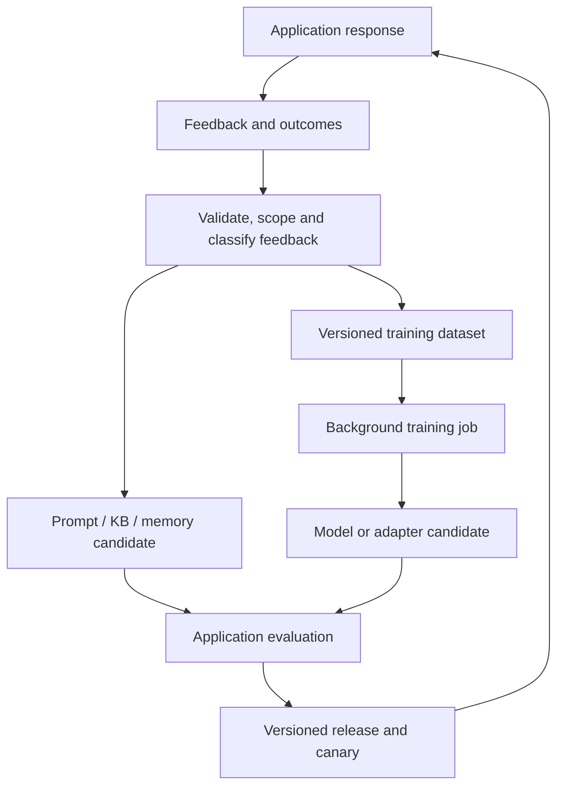

# Continuous model improvement from application feedback

Status: exploratory design proposal, 2026-11-03. This document describes a possible
extension to Loopiter, not a shipped trainer, supported API, or production guarantee.

## Goal

Loopiter should turn application feedback into measured improvements across the
prompt, knowledge base, scoped memory, and, when training is available, the model
itself. The objective is better performance for a specific application or use case,
not a claim that every update improves the model's general intelligence.

Feedback should enter the learning pipeline as it arrives. Context changes and
model training can operate at different cadences while sharing evidence,
evaluation, versioning, deployment, and recovery.

## What exists today

The standalone SDK and optional platform are separate projects. These observations
describe the source inspected when this proposal was written:

- The SDK already records executions, feedback signals, model/prompt versions,
  immutable candidates, evaluations, approvals, and deployment/rollback receipts.
  Its generic [candidate contracts](../src/contracts.ts) include a `model` target.
- The [improvement workflow](../src/improvement-contracts.ts) has optimization,
  validation, and audit partitions, deployment adapters, canary hooks, and production
  observation. These are useful foundations for model-release experiments.
- The [autonomous policy validator](../src/improvement-evidence.ts) currently
  permits only `prompt`, `routing`, and `agent_release` targets. The controller
  creates low-risk candidates. Adding model training requires a deliberate policy
  and lifecycle extension; the generic target enum does not enable it.
- The SDK does not own model training, scheduling, or customer infrastructure.
  See the [current architecture](architecture.md) and
  [autonomy design notes](autonomy-design-notes.md).
- The optional platform currently coordinates prompt and knowledge releases and
  supports OpenRouter, Bedrock, and application adapters for inference. It does
  not currently provide the model-training lifecycle proposed here.

Updating a Markdown file changes application context only if the application loads
that version into its requests or retrieval system. Editing `.md` files does not
change model weights or automatically update an already-running application's
context.

## Two improvement cadences

| Path | Changes | Intended cadence |
| --- | --- | --- |
| Context | Prompt, rules, retrieved knowledge, scoped memory or Markdown | Upcoming requests after validation and activation |
| Model | A fine-tuned checkpoint or trainable adapter | Background batches when evidence, compute, and evaluation permit |

The context path can apply a verified lesson while a training dataset is still
growing. The model path can consolidate recurring lessons into learned behavior.
Training latency depends on model size, data, hardware, queueing, and evaluation;
there is no universal near-real-time training interval or minimum example count.

True online learning is technically possible. For example, experimental Online DPO
generates fresh responses during training and obtains preferences for them. It is
not equivalent to safely mutating production weights after each user rating. The
first implementation should train separate candidates and promote evaluated
versions while the current release continues serving.



Feedback may support one path, both paths, or no change. A completed training job is
an artifact-production event; improvement requires independent evaluation.

## Route each lesson to the right place

| Feedback or failure | Likely first intervention |
| --- | --- |
| "My preferred language is Spanish" | Scoped user memory |
| "Our cancellation policy changed" | Verified authoritative knowledge update |
| "Answers should use this structure" | Prompt or output constraints; training if the pattern persists |
| Repeated mistakes on a stable support-intent taxonomy | Corrected examples for supervised fine-tuning |
| A reviewer prefers one valid response over another | Preference data for DPO |
| An agent repeatedly chooses the wrong tool | Examine tool definitions, instructions, and action trajectories |
| A tool, integration, or source is broken | Fix the underlying application or data source |

Loopiter should recommend an intervention based on the failure and available
capabilities, then test whether that intervention helps. Every feedback event does
not need a training job. Personal preferences should not silently become global
model behavior, and rapidly changing facts are usually better kept in retrieval.

## Training methods and feedback requirements

Start with supervised fine-tuning (SFT) using LoRA. SFT learns from examples of the
desired response. LoRA updates a smaller set of adapter parameters while freezing
the base weights; the base plus adapter becomes the adapted model at inference.
The learning objective and parameter-update method are separate choices: LoRA
can be used with more than one training objective.

| Method | Required evidence | Initial role |
| --- | --- | --- |
| SFT | Application input/context and a verified desired response | First training experiment |
| DPO | Preferred and rejected responses for the same input/context | Later, when reliable preference pairs exist |
| Reinforcement learning | Relevant trajectories and trustworthy reward signals | Later, for replayable tasks with measurable outcomes |

A thumbs-down is evidence of dissatisfaction, but is not by itself a corrected SFT
answer or a complete DPO pair. Loopiter could generate a proposed correction and
have it verified; generation alone must not promote it to trusted training data.
Binary feedback can support other learning approaches, but those require their own
data assumptions and evaluation.

For an agent, improving its response stage and improving action selection are
different scopes. Tool-use training needs the relevant observations, actions, tool
results, and task outcomes. Final-response logs alone cannot establish why a
multi-step task succeeded or failed.

## Proposed architecture additions

### 1. Training-data builder

Join eligible feedback to the exact execution and relevant context as served:
conversation, retrieved evidence, available tools, and model/prompt versions.
Observational telemetry may be metadata-only and is not automatically training-ready.

Resolve contradictory corrections, deduplicate examples, preserve provenance, and
enforce customer scope, data-use permissions, and retention rules. Partition by
entity and time so the same conversation or near-duplicate example does not leak
across training and evaluation.

Create immutable dataset manifests with source identities, hashes, filtering
versions, and partition membership. Keep independent evaluation data inaccessible
to both the optimizer and trainer. Mix appropriate earlier training examples into
later runs and retain evaluation coverage of older capabilities to detect forgetting.

### 2. Separate inference and training integrations

A deployment may expose inference without training. Model-training eligibility
depends on the specific model, accessible weights or customization API, license,
account permissions, and supported deployment path. Self-hosting an endpoint does
not itself make the underlying model trainable.

Introduce an optional training-backend contract for capability discovery, job
submission, status inspection, cancellation, and artifact retrieval. Keep this
separate from inference generation/embedding callbacks and from deployment adapters.
It is a proposed contract, not an existing SDK API.

Implement one backend first: either SageMaker AI or a customer-run Python training
worker. The SDK should coordinate evidence and lifecycle without requiring a hosted
Loopiter account or bundling GPU frameworks into its core. The platform can add
managed scheduling and provider integration separately.

### 3. Durable training jobs and compute accounting

Record training jobs independently from candidate evaluation and serving deployment.
A proposed lifecycle is:

```text
dataset_ready -> queued -> training -> artifact_ready -> evaluating
             -> selected -> deploying -> observing -> promoted
```

Represent failure, cancellation, rejection, stale baselines, and uncertain external
results explicitly. Submission needs a stable idempotency identity; after a lost
response, inspect the provider job before submitting another paid run. Poll jobs
across worker restarts instead of keeping a long training process inside an ordinary
proposal callback or database transaction.

Add training budgets for estimated/reserved and actual compute cost, maximum run
duration, concurrency, and storage. The current inference request/token accounting
does not bound GPU training spend. Cancellation and late completion also need
reconciliation; a cancelled job must not later become an active model accidentally.

### 4. Immutable model artifacts and application releases

Record the base-model revision, parent checkpoint/adapter, tokenizer and chat
template, trained-artifact location and hash, dataset hash, training recipe/version,
hyperparameters, job identity, and evaluation results.

Extend the application release manifest to pin the model artifact together with
the prompt, knowledge snapshot, and relevant memory configuration. Attribute each
execution to the actual combination it used. Preserve immutable adapter identities
rather than replacing the weights behind a previously evaluated version name.

Deploy through adapters that implement idempotent apply, inspection, and rollback.
The serving layer must actually select the intended checkpoint or adapter. If a
fast context update changes the baseline while training is running, evaluate the
trained artifact against the current compatible release before deployment.

### 5. Model-specific policy, evaluation, and rollout

Extend the current autonomous policy explicitly for model changes, with appropriate
risk classification, training permissions, compute budgets, and deployment gates.
Do not enable model training merely by widening the target allow-list or hiding a
weight update inside an existing low-risk release.

First compare the candidate model against the current model with prompt and
knowledge held fixed. Then evaluate the complete proposed application release.
Measure task quality, important failure slices, retention of earlier capabilities,
latency, and total cost. Prefer deterministic task checks where possible and
calibrate any model-based judges against reviewed examples.

Use fresh held-out evidence and production canaries before broad promotion. A
better training loss or judge score alone does not establish application value.
Low traffic or immature outcomes should leave the experiment waiting rather than
be treated as proof of success. Rollback restores a known compatible release.

## Deployment options

- **SageMaker AI:** supports model customization paths including SFT, DPO,
  reinforcement fine-tuning, LoRA, and full fine-tuning. Exact model, method, and
  infrastructure availability must be checked for the chosen deployment.
- **Self-hosted:** Hugging Face TRL and PEFT can train adapters; a compatible serving
  engine such as vLLM can serve base models and named adapters. vLLM supports
  per-request adapter selection. Dynamic adapter-management endpoints require an
  isolated, fully trusted environment; preloaded immutable versions or controlled
  deployments are alternative rollout mechanisms.
- **Bedrock:** selected models and regions support customization, so it should not
  be categorically excluded. Inference access to a particular model does not imply
  fine-tuning access to that model.
- **Inference-only deployments:** continue using context improvements. Training a
  separate application-specific student is a possible future path if suitable
  training data and model access are available; it does not alter the original model.

## First experiment and delivery sequence

Choose one stable application task, one trainable model that fits the compute
budget, and verified corrections. A support-intent classifier or constrained
response task would make the first experiment easier to measure.

Compare four configurations on the same independent cases:

| Configuration | Purpose |
| --- | --- |
| Current model and current context | Baseline |
| Current model and improved context | Value of the fast loop |
| Trained model and current context | Value of training alone |
| Trained model and improved context | Combined application value |

Suggested delivery sequence:

1. Build dataset export, provenance, and independent evaluation around one task.
2. Run an external LoRA SFT experiment and measure whether it adds value beyond
   context improvements. A negative result is useful; do not assume training wins.
3. Add one durable training integration, model artifact records, and reviewed
   deployment/rollback through the existing candidate lifecycle.
4. Extend policy and serving attribution, then add bounded automatic triggering and
   canary promotion when enough eligible new evidence exists.
5. Consider preference learning and task-level reinforcement learning after their
   required evidence and evaluation environments exist.

After a successful combined release, test whether learned behavior permits shorter
prompts or fewer retrieved examples. Remove guidance only after an ablation shows
that the application retains the required behavior.

## Product questions to resolve

- Is the first training backend customer-operated or managed by the platform?
- Is the first goal higher task quality, lower inference cost, or both under an
  explicit tradeoff?
- Which feedback sources can supply trusted corrections and preferences?
- Should adaptation be application-wide, customer-specific, or both? What evidence
  and operational cost justify a separate adapter?
- When should Loopiter recommend collecting more evidence instead of training?
- Which initial task has enough stable, reviewed data to demonstrate incremental
  value over prompt and knowledge improvements?

The intended product capability is to turn application feedback into tested
improvements across context and model behavior, using the capabilities available
in each deployment. Continuous data collection does not imply that every feedback
event causes a deployment or that every trained candidate is better.

## References

Provider and library capabilities change. These sources informed the proposal;
check current support before selecting a model or implementing an integration.

- [Amazon SageMaker AI model customization](https://docs.aws.amazon.com/sagemaker/latest/dg/customizing-models.html)
- [Hugging Face TRL supervised fine-tuning and PEFT integration](https://huggingface.co/docs/trl/en/sft_trainer)
- [Hugging Face TRL direct preference optimization](https://huggingface.co/docs/trl/en/dpo_trainer)
- [Hugging Face TRL experimental Online DPO](https://huggingface.co/docs/trl/en/online_dpo_trainer)
- [vLLM LoRA adapter serving](https://docs.vllm.ai/en/stable/features/lora/)
- [Amazon Bedrock supported fine-tuning models and regions](https://docs.aws.amazon.com/bedrock/latest/userguide/custom-model-fine-tuning.html)
